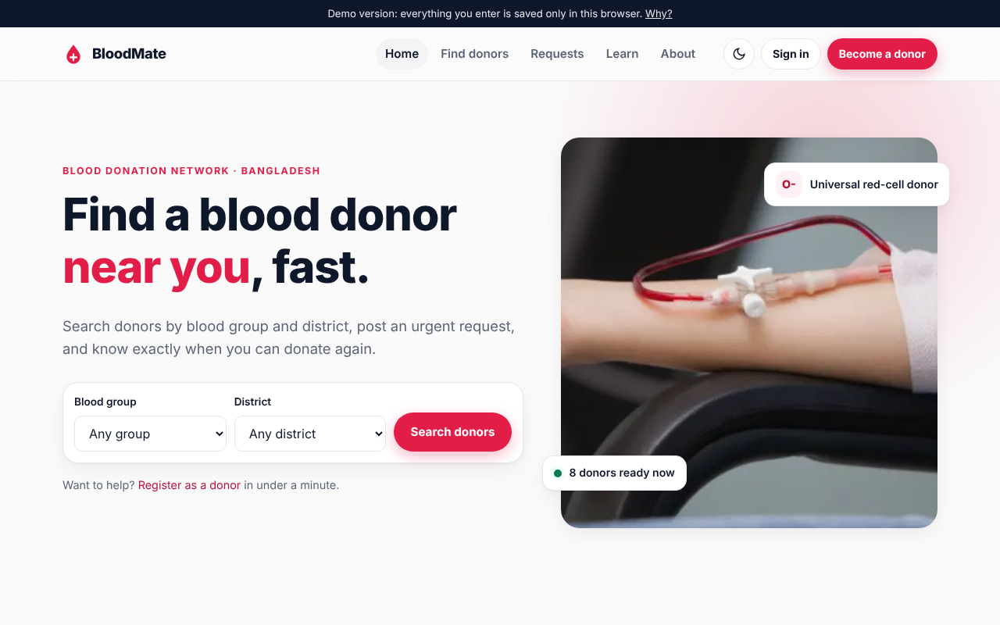
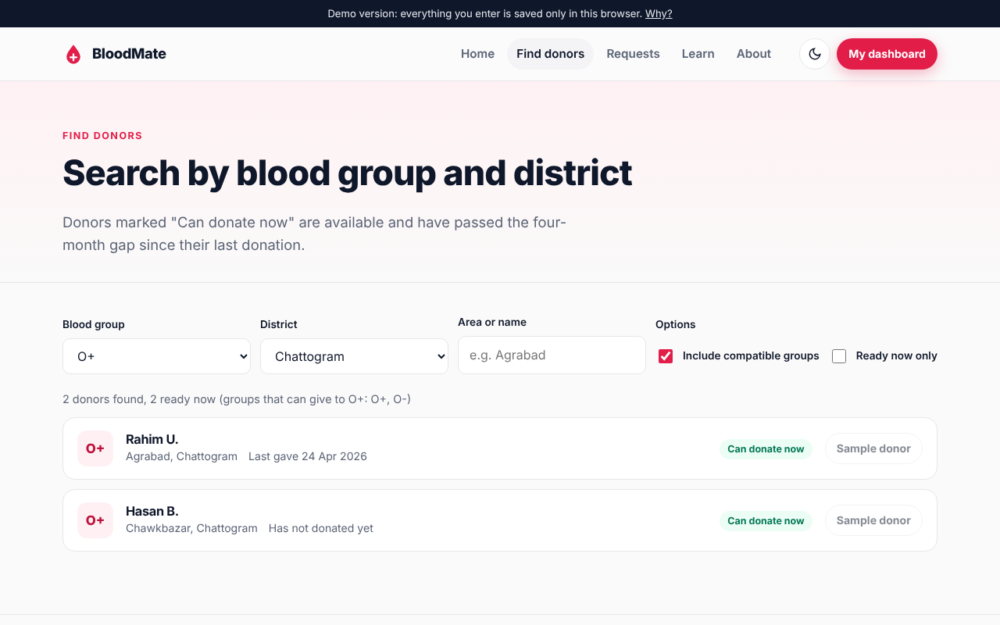
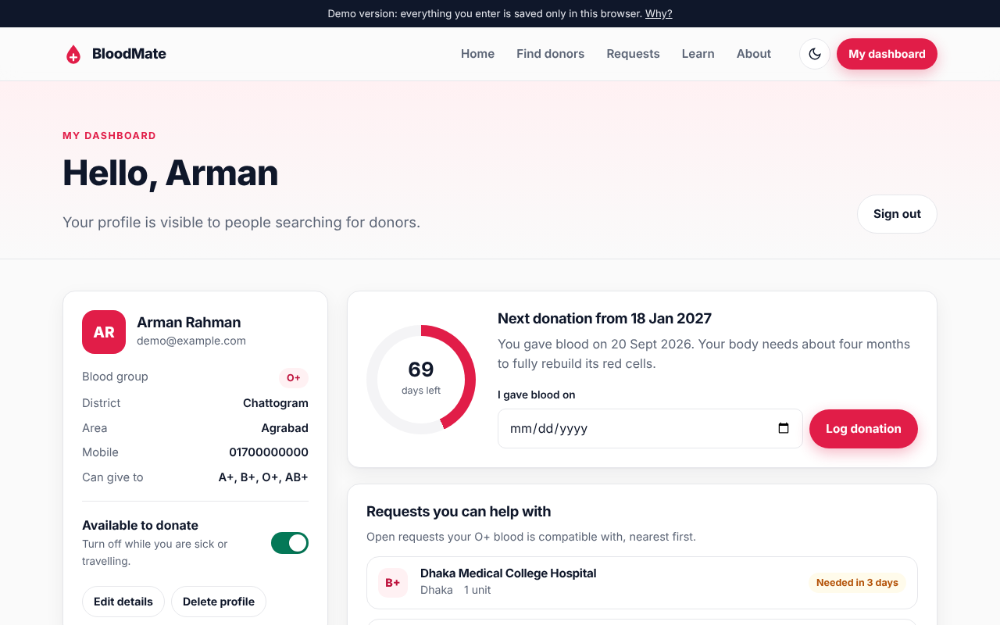

# BloodMate

**A blood donor website for Bangladesh. Find donors by blood group and district, post urgent blood requests, and track when you can donate again.**



## What you can do

- **Find donors** by blood group and any of Bangladesh's 64 districts. Tick "Include compatible groups" to see every group that can safely give to the patient. Donors who are available and past the four-month gap show as *Can donate now*.
- **Post emergency requests** with the hospital, number of bags and deadline. Requests are sorted by urgency, and donors can filter to the ones their blood can help.
- **Register as a donor** with sign-up checks for age, weight, Bangladeshi mobile numbers and the last donation date.
- **Use your dashboard** to turn availability on or off, log donations, see a countdown to your next eligible date, view matching requests nearby and manage your own requests.
- **Check compatibility** with an interactive chart of who can give to whom.
- **Read the donation guide**: eligibility, timing, before and after care, blood groups and common myths.
- Light and dark theme, mobile-friendly layout, keyboard and screen-reader friendly forms.

| Find donors | Dashboard |
| --- | --- |
|  |  |

## How it's built

Plain HTML, CSS and JavaScript, with no framework and no build step.

```
index.html        home: quick search, live numbers, compatibility checker, urgent requests
find.html         donor search with filters (URL keeps the filters, so searches can be shared)
requests.html     emergency requests list and form
register.html     donor sign-up with validation
login.html        sign in
dashboard.html    donor dashboard
learn.html        donation guide
about.html        about the project
assets/js/app.js  data layer (Store), blood-group rules, shared header and footer
assets/css/style.css  design tokens, light and dark themes, components
```

**Status: complete front end, demo data layer.** There is no server yet, so profiles, requests and donations are saved in the visitor's own browser (`localStorage`). The site starts with clearly marked sample donors and requests. All reads and writes go through the `Store` object in `assets/js/app.js`, so it can be swapped for a real API later without touching the pages.

## Run it

Open `index.html` in a browser, or serve the folder:

```
python3 -m http.server
```

## History

I built the first version in 2023 as my first full website, with HTML, CSS, Bootstrap and jQuery. It is kept on the [`v1-2023` branch](https://github.com/Armanbro007/blood/tree/v1-2023). In 2026 I rebuilt it from scratch with a new design and working features.
